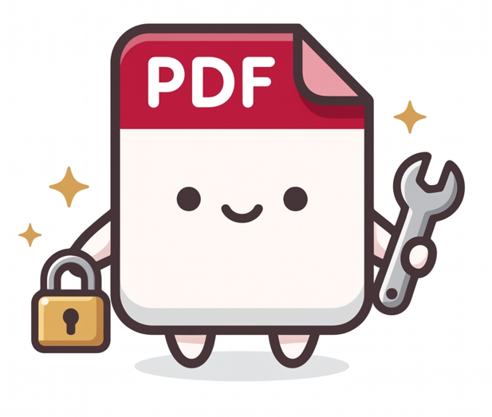

<div align="center">

  

  # OwnPDF

  **Your PDFs. Your device. Your privacy.**

  *A blazing-fast, privacy-first PDF utility suite powered by WebAssembly. Unlock, protect, merge, split, organize, convert, and inspect documents 100% in your browser.*

  <p align="center">
    <a href="https://github.com/Titanium-xd/OwnPDF/blob/main/LICENSE"></a>
    <a href="https://github.com/Titanium-xd/OwnPDF"></a>
  </p>

  <p align="center">
    <a href="#-why-ownpdf">Why OwnPDF?</a> •
    <a href="#-features">Features</a> •
    <a href="#-architecture--privacy">Architecture & Privacy</a> •
    <a href="#-tech-stack">Tech Stack</a> •
    <a href="#-getting-started">Getting Started</a> •
    <a href="#-verification--testing">Testing</a>
  </p>

</div>

---

## 💡 Why OwnPDF?

Every day, millions of people upload sensitive documents—**e-Aadhaar cards, bank account statements, tax filings, salary slips, and medical records**—to random cloud PDF websites just to remove a password, merge two pages, or split a chapter.

Those servers gain full access to your most confidential information.

**OwnPDF solves this completely.**
By compiling industry-standard PDF engines (**QPDF** and **pdf-lib**) directly to **WebAssembly** and executing them inside client-side Web Workers, OwnPDF brings desktop-class PDF manipulation into your web browser. 

- 🚫 **Zero Server Uploads**: No backend server exists. Files never leave your local RAM.
- 🛡️ **Zero Tracking**: No Google Analytics, telemetry, cookies, or remote logging.
- ⚡ **Hardware Accelerated**: Multi-threaded Web Workers with zero main-thread UI freezing.
- 🎨 **Modern Sky-Blue Aesthetic**: Beautiful, fluid design with adaptive dark/light themes and bundled local typography.

---

## ✨ Features

OwnPDF provides eight comprehensive, production-grade PDF tools:

### 1. 🔓 Unlock PDF (Password Removal)
*Permanently remove document opening passwords from authorized files.*
- **Ideal for:** Indian e-Aadhaar cards, bank e-statements, locked payslips, and invoices.
- **Engine:** Client-side **QPDF WebAssembly Worker** for cryptographic decryption.
- **Safety:** Clear diagnostics distinguishing wrong passwords from corrupted documents.
- **Preview:** Instant first-page canvas preview rendered with Mozilla PDF.js.

### 2. 🛡️ Protect PDF (AES-256 Encryption)
*Secure your documents with military-grade encryption.*
- **Standard:** Genuine **AES-256 bit** document encryption.
- **Entropy Meter:** Real-time visual password strength assessment.
- **Pre-download Check:** Verifies header validity before saving.

### 3. 📑 Merge PDF
*Combine multiple documents, certificates, or assignments into one unified file.*
- **Drag & Reorder:** Interactive file sequence manager with move up/down controls.
- **Multi-source:** Merge files from your session queue or pick new files on the fly.
- **Integrity:** Preserves document resolution and vector elements.

### 4. ✂️ Split PDF & Extract Pages
*Extract specific portions of large documents with precision.*
- **Flexible Ranges:** Syntax support for custom ranges (e.g. `1-3, 5, 8-12`).
- **Single Page Extraction:** Split all pages into separate standalone documents.
- **Smart Export:** Download individual slices or bundle everything into a single **ZIP archive** (powered by JSZip).

### 5. 🗂️ Organize Pages
*Visual page organizer with interactive page-level management.*
- **Live Gallery:** HiDPI thumbnail grid rendered directly from PDF vectors.
- **Page Operations:** Rotate pages clockwise (90° increments), reorder via drag/click, or delete unwanted sheets.
- **Safety Net:** Instant undo capability for deleted pages before saving.

### 6. 🖼️ Images to PDF
*Transform images into beautifully formatted PDF documents.*
- **Formats:** Full support for PNG, JPG, and JPEG.
- **Layouts:** Standard **A4**, **US Letter**, or **Fit to Image**.
- **Controls:** Margin sliders and auto/portrait/landscape orientation detection.

### 7. 🗜️ Compress PDF
*Optimize PDF structures without cloud compromises.*
- **Techniques:** Structural linearization (Fast Web View), object stream consolidation, and unused object pruning.
- **Honest Reporting:** Transparently compares original vs. optimized size; notifies you if a document is already optimal.

### 8. 🔍 Inspect & Sanitize Metadata
*Audit document security and erase sensitive tracking data.*
- **Deep Audit:** Inspect PDF versions, page counts, title, author, producer, creation/modification dates, and catalog dictionaries.
- **One-Click Sanitizer:** Strips all identifying metadata attributes and embedded XMP tracking packets.

---

## 🔒 Architecture & Privacy

```
                                [ OwnPDF Client Environment ]
  ┌──────────────────────────────────────────────────────────────────────────────┐
  │                                                                              │
  │  User Device (RAM)                                                           │
  │  ┌───────────────────────┐         ┌──────────────────────────────────────┐  │
  │  │   React 19 UI Thread  │         │         Dedicated Web Worker         │  │
  │  │   • Sky-Blue Theme    │         │  ┌────────────────────────────────┐  │  │
  │  │   • Local Fonts       │ Transfer│  │       QPDF WebAssembly         │  │  │
  │  │   • PDF.js Previews   ├─────────┼─►│  • Decryption (AES-256)        │  │  │
  │  │   • Session Storage   │ Array   │  │  • Encryption                  │  │  │
  │  │   • Download Manager  │ Buffer  │  │  • Virtual MemFS Sandbox       │  │  │
  │  └───────────▲───────────┘         │  └────────────────┬───────────────┘  │  │
  │              │                     │                   │ Output Stream    │  │
  │              │ Blob Stream         │                   ▼                  │  │
  │  ┌───────────┴───────────┐         │  ┌────────────────────────────────┐  │  │
  │  │ File System Access    │◄────────┼──┤      Clean TypedArray View     │  │  │
  │  │ • showSaveFilePicker  │         │  │   • %PDF- signature verified   │  │  │
  │  │ • Anchor Fallback     │         │  └────────────────────────────────┘  │  │
  │  └───────────────────────┘         └──────────────────────────────────────┘  │
  │                                                                              │
  └──────────────────────────────────────┬───────────────────────────────────────┘
                                         │
                             No Network Calls (CSP: self)
                                         ▼
                            [ 🌐 External Internet: 0 Bytes ]
```

### Privacy Guarantees
1. **Best-Effort Memory Hygiene:** Document data and passwords exist solely in ephemeral memory during the active session.
2. **Instant "Clear Session":** The persistent Clear Session button purges all active document buffers, revokes all created `blob:` URLs, and terminates active Web Workers immediately.
3. **Download Safety:** Uses the native **File System Access API** (`showSaveFilePicker`) when supported, allowing direct-to-disk streaming and preventing browser UUID filename fallback bugs. Cleanly cancels on user `AbortError` without rogue duplicate downloads.
4. **Content Security Policy (CSP):** Ships with strict CSP directives preventing network exfiltration of file buffers.

---

## 🛠️ Tech Stack

| Layer | Technology | Purpose |
| :--- | :--- | :--- |
| **Framework** | [React 19](https://react.dev/) + [TypeScript](https://www.typescriptlang.org/) | Strict-mode frontend runtime |
| **Bundler & Dev** | [Vite 6](https://vite.dev/) | Sub-second HMR and production bundle optimization |
| **Styling** | [Tailwind CSS v4](https://tailwindcss.com/) | Custom sky-blue design tokens & dark mode |
| **Core PDF Engine** | [QPDF WASM](https://github.com/neslinesli93/qpdf-wasm) | Cryptographic decryption, encryption, and linearization |
| **Transforms** | [pdf-lib](https://pdf-lib.js.org/) | In-memory page manipulation, merges, splits, and metadata |
| **Canvas Previews** | [Mozilla PDF.js](https://mozilla.github.io/pdf.js/) | Fast, on-device vector thumbnail rendering |
| **Multi-File Archiving**| [JSZip](https://stuk.github.io/jszip/) | In-memory ZIP packaging for split documents |
| **Typography** | [Fontsource](https://fontsource.org/) | Locally bundled **Manrope** (headings) & **Inter** (body) |
| **Icons** | [Lucide React](https://lucide.dev/) | Crisp, modern UI icons |
| **Testing** | [Vitest](https://vitest.dev/) | Unit tests, crypto benchmarks, and network isolation assertions |

---

## 🚀 Getting Started

### Prerequisites
- **Node.js**: `v20.x` or `v22.x`+ recommended
- **npm**: `v10.x`+

### 1. Clone & Install
```bash
git clone https://github.com/Titanium-xd/OwnPDF.git
cd OwnPDF
npm install
```

### 2. Run Development Server
```bash
npm run dev
```
Open **[http://localhost:5173](http://localhost:5173)** in your browser.

### 3. Build for Production
```bash
npm run build
npm run preview
```
The optimized static bundle will be generated in `dist/`.

---

## 🧪 Verification & Testing

OwnPDF includes a comprehensive Vitest test suite covering cryptographic operations, filename sanitization, sub-slice typed-array bounds, and network isolation:

```bash
# Run all unit, crypto, and privacy tests
npm test
```

### Test Coverage Highlights:
- ✅ **Decryption & PDF.js Verification:** Tests that AES-256 encrypted documents cannot be opened without a password, decrypts via QPDF WASM, validates the `%PDF-` signature, and verifies password-free rendering in PDF.js.
- ✅ **Download Buffer Isolation:** Tests that TypedArray sub-slices with non-zero offsets are cleanly copied so external ArrayBuffer padding is never leaked.
- ✅ **Filename Sanitization:** Tests path-traversal prevention, special character filtering, case-insensitive `.pdf` extension handling, and deduplication of suffixes.
- ✅ **File System Access API Cancellation:** Tests that canceling `showSaveFilePicker()` (`AbortError`) terminates cleanly without fallback anchor clicks.
- ✅ **Network Isolation:** Verifies zero outgoing fetch/XHR calls occur during local document processing.

---

## 🌐 Static Deployment

OwnPDF is 100% static and can be deployed anywhere with zero server configuration.

### Vercel
A pre-configured `vercel.json` is included with security headers and WASM MIME types:
```bash
npx vercel
```

### Cloudflare Pages / Netlify / GitHub Pages
Deploy the `dist/` folder directly to any static web host.

---

## 📄 License & Acknowledgements

OwnPDF is open-source software licensed under the **[MIT License](LICENSE)**.

### Open-Source Acknowledgements
- **QPDF WASM**: [Artistic License 2.0 / ISC](https://github.com/neslinesli93/qpdf-wasm)
- **pdf-lib**: [MIT License](https://github.com/Hopding/pdf-lib)
- **Mozilla PDF.js**: [Apache License 2.0](https://github.com/mozilla/pdf.js)
- **Lucide Icons**: [ISC License](https://lucide.dev/)

---

<div align="center">
  <sub>Built with ❤️ for true document privacy. Made by <a href="https://github.com/Titanium-xd">Titanium-xd</a>.</sub>
</div>
