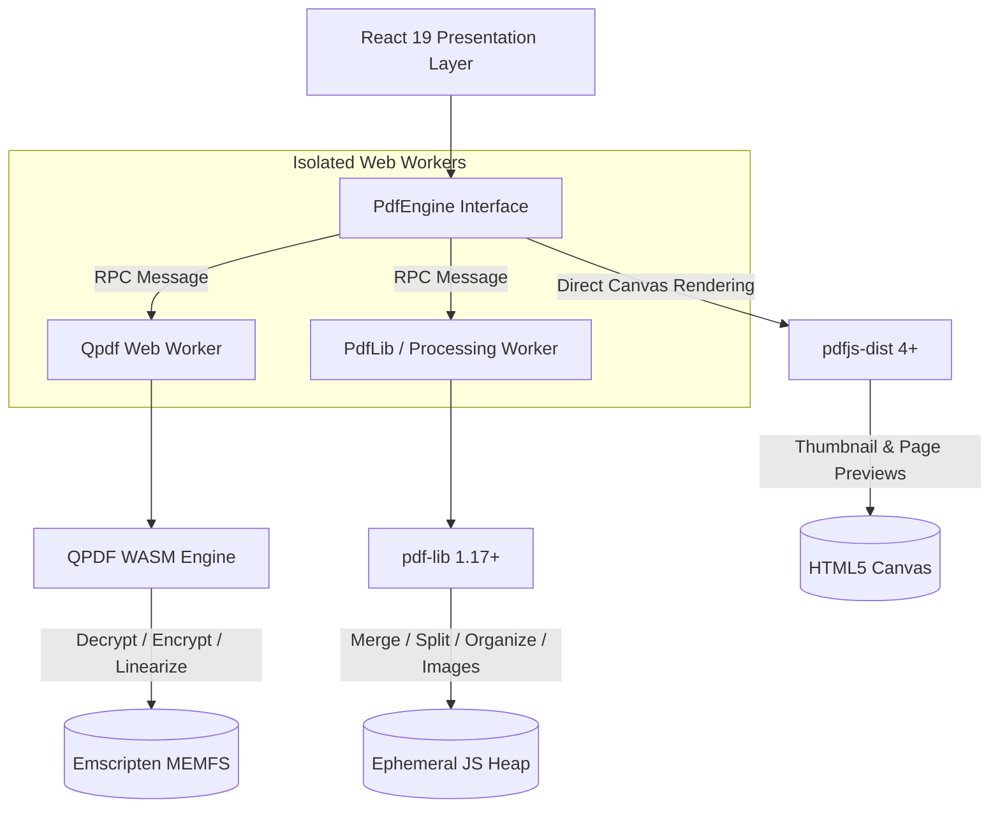
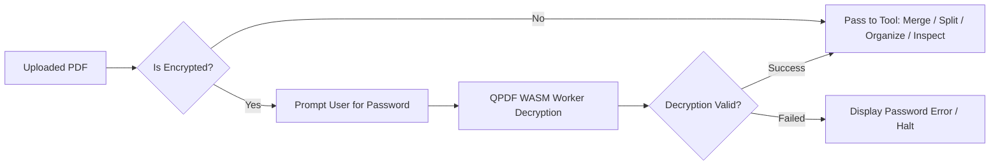

# OwnPDF — Technical Architecture

## 1. System Overview & Vision

**OwnPDF** is a local-first, privacy-respecting PDF utility web application designed to run entirely on the user's client device. 

The core architectural tenet is **Zero-Server Document Processing**:
- No document bytes, passwords, metadata, or extracted texts are ever transmitted over the network.
- All PDF manipulation, cryptographic operations, conversions, and previews execute inside client browser processes using WebAssembly (WASM), Web Workers, and JavaScript PDF engines.
- The web application is deployed as a purely static frontend without API routes, databases, cloud storage, telemetry, or server-side functions.

---

## 2. PDF Engine Evaluation & Dependency Selection

### 2.1 Evaluation of `pdfstudio`
The project evaluated whether the npm package `pdfstudio` could serve as a typed wrapper for QPDF WASM:
- **Registry Inspection:** A query against the npm registry (`npm view pdfstudio`) yielded no results.
- **Ecosystem Analysis:** Historically, "PDF Studio" referred to a commercial desktop Java application created by Qoppa Software. There is no supported open-source npm package by this name.
- **Conclusion:** We reject reliance on unverified or hypothetical packages and use direct, verified WebAssembly builds.

### 2.2 Evaluation of Candidate QPDF WASM Packages

| Criteria | `@neslinesli93/qpdf-wasm` (v0.3.0) | `@wasm-zoo/qpdf` (v0.1.1) |
| :--- | :--- | :--- |
| **Upstream QPDF Version** | QPDF 10.6.3 | QPDF 12.4.2 |
| **Package Size** | ~1.38 MB unpacked (~468 KB gzip) | ~2.32 MB unpacked (~723 KB gzip) |
| **License** | ISC (wrapper) / Artistic License 2.0 (QPDF) | MIT (wrapper) / Artistic License 2.0 (QPDF) |
| **Browser & Worker Support** | Verified in production tools (Orbit PDF, PDFMergely) | Modern ESM, uses `import.meta.url` |
| **VFS (MEMFS) Control** | Direct Emscripten `FS` API (`writeFile`, `readFile`, `unlink`) | Higher-level `exec({ files, outputs })` |
| **Decryption / Encryption** | Full support (AES-128, AES-256) | Full support (AES-128, AES-256) |
| **Vite Bundler Compatibility** | Reliable with public WASM asset serving | Supported with ES module imports |

**Selection Decision:**
We select `@neslinesli93/qpdf-wasm` (pinned to `0.3.0`) as our primary WASM runtime due to its battle-tested stability in browser Web Workers, direct low-level control over the Emscripten Virtual File System (`FS.unlink` for immediate data cleanup), and compact footprint (~1.3 MB). 

### 2.3 Layered Engine Responsibilities



1. **QPDF WebAssembly:**
   - Decryption of password-protected PDFs (e.g. e-Aadhaar, bank statements, locked invoices).
   - AES-256 encryption with custom user and owner passwords.
   - Lossless structural optimization and linearization (`--linearize --object-streams=generate`).
2. **`pdf-lib` (v1.17+):**
   - Merging multiple PDF documents.
   - Splitting pages and extracting ranges.
   - Page organization: rotation (90°, 180°, 270°), deletion, reordering.
   - Converting PNG and JPEG images into clean PDFs.
   - Sanitizing document catalog metadata.
3. **`pdfjs-dist` (v4/v5):**
   - High-fidelity client-side page rendering into `<canvas>` elements for previews and thumbnail grids.
   - Encryption detection (`PasswordException`).

---

## 3. Worker Isolation & Concurrency Model

### 3.1 Off-Main-Thread Execution
To maintain a 60fps responsive user interface:
- All cryptographic operations (decryption, AES encryption) execute inside `qpdf.worker.ts`.
- All computationally heavy multi-page transformations (`pdf-lib` merges, multi-page splits, image embeddings) execute inside `pdflib.worker.ts` or asynchronously in dedicated worker instances.
- Zero PDF byte parsing or decryption occurs on the main UI thread.

### 3.2 Worker RPC Protocol & Memory Transfer
Communication between the main thread and workers follows a strict typed RPC contract using **transferable `ArrayBuffer` objects**:
- Input `Uint8Array.buffer` is transferred to the worker, transferring ownership without cloning overhead.
- Output buffers are transferred back to the main thread.
- If an operation fails, the worker catches errors and returns structured serializable errors (`PdfError`).

```typescript
export type WorkerRequest = 
  | { id: string; type: 'DECRYPT'; fileData: ArrayBuffer; password: string }
  | { id: string; type: 'ENCRYPT'; fileData: ArrayBuffer; userPassword?: string; ownerPassword?: string; keyLength: 128 | 256 }
  | { id: string; type: 'OPTIMIZE'; fileData: ArrayBuffer }
  | { id: string; type: 'MERGE'; files: ArrayBuffer[] }
  | { id: string; type: 'SPLIT'; fileData: ArrayBuffer; ranges: string }
  | { id: string; type: 'ORGANIZE'; fileData: ArrayBuffer; operations: PageOp[] };

export type WorkerResponse =
  | { id: string; ok: true; output: ArrayBuffer; metadata?: Record<string, unknown> }
  | { id: string; ok: false; error: string; code: PdfErrorCode };
```

### 3.3 Limits, Timeouts & Cancellation
- **Tested File Size Recommendation:** Files up to **100 MB** are supported smoothly. For files exceeding 100 MB, a performance notice is displayed warning of potential browser memory constraints.
- **Worker Timeouts:** Operations have a 60-second execution deadline. If an unrecoverable hang occurs, the worker is forcibly terminated (`worker.terminate()`), a fresh worker is spawned, and a recoverable error is reported to the user.
- **Out of Memory (OOM) Protection:** Memory allocation failures in WASM throw `ExitStatus` or WebAssembly errors. These are caught, the virtual filesystem is purged, and a descriptive recovery message is displayed.

---

## 4. Encrypted-Document Routing Policy

> [!IMPORTANT]
> **Never pass an encrypted PDF directly into `pdf-lib`.**

`pdf-lib` cannot parse or manipulate encrypted cross-reference streams or standard security handlers (throwing `EncryptedPDFError`). The system enforces the following pipeline:



1. When any tool receives a document, `PdfEngine.isEncrypted(fileData)` inspects the document.
2. If encrypted, the application halts pipeline execution and prompts the user for the document password.
3. Decryption is performed via QPDF WASM.
4. Output integrity is validated by loading the first page structure.
5. Only once decrypted successfully is the unencrypted document handed off to downstream tools.

---

## 5. Metadata Sanitization Scopes

OwnPDF v1 provides explicit, documented metadata sanitization. We do not claim vague "complete privacy scrubbing."

### Fields Stripped in v1:
- `/Title`
- `/Author`
- `/Subject`
- `/Keywords`
- `/Creator`
- `/Producer`
- `/CreationDate`
- `/ModDate`
- Standard embedded XML XMP metadata packets (`/Metadata` stream in Catalog).

### Known Limitations (Not removed in v1):
- Proprietary printer marks or job tickets.
- Font descriptor metadata embedded within subsetted fonts.
- Content-stream text comments or structural object IDs.
- Hidden vector layers or invisible text streams.

Users are presented with an honest breakdown of removed fields versus persistent structural elements.

---

## 6. Static Hosting & Production Deployment

- **Deployment Model:** Pure static frontend deployed to Vercel (or any static host / GitHub Pages).
- **Zero Serverless Compute:** No backend API routes or server-side functions.
- **Asset Routing:** 
  - `qpdf.wasm` and `pdf.worker.min.mjs` are placed in the `public/` folder and served with correct MIME types (`application/wasm`, `text/javascript`).
- **Content Security Policy (CSP):**
  Configured in headers:
  ```http
  Content-Security-Policy: default-src 'self'; script-src 'self' 'wasm-unsafe-eval'; worker-src 'self' blob:; style-src 'self' 'unsafe-inline' https://fonts.googleapis.com; font-src 'self' https://fonts.gstatic.com; img-src 'self' data: blob:; connect-src 'self' blob:; object-src 'none'; frame-ancestors 'none';
  ```
