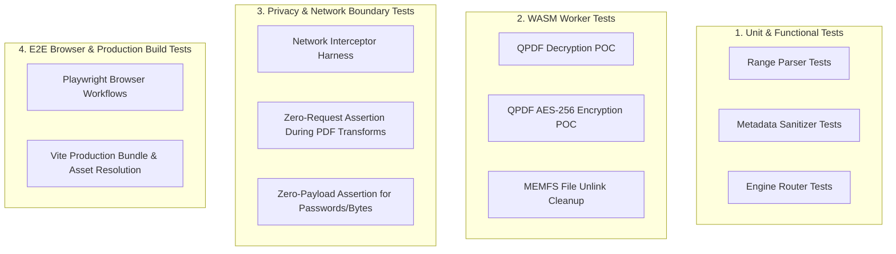

# OwnPDF — Test Plan & Quality Assurance Strategy

## 1. Test Data Hygiene & Ethical Testing

> [!CAUTION]
> **Zero Personal Data Rule:**
> Automated tests, fixtures, screenshots, debug logs, and repositories must **NEVER** use real identity cards (such as e-Aadhaar), personal financial statements, or private user files.

All testing utilizes **purely synthetic fixtures** generated programmatically via `scripts/generate-fixtures.ts`:

| Fixture Name | Description | Test Role |
| :--- | :--- | :--- |
| `fixture-unencrypted.pdf` | Clean 2-page PDF containing sample vector text | Baseline document for protect, inspect, merge, compress |
| `fixture-encrypted-aes256.pdf` | AES-256 encrypted PDF with user password `testpass123` | Password unlocking, incorrect password handling |
| `fixture-multipage.pdf` | 5-page PDF with labeled page numbers (Page 1..5) | Split, extract, rotate, reorder, delete page operations |
| `fixture-corrupt.pdf` | Truncated binary header with random bytes | Error handling, corrupted file detection |
| `fixture-image-1.png`, `fixture-image-2.jpg` | Synthetic 800x600 test images with colored shapes | Image-to-PDF conversion |

---

## 2. Test Architecture

The testing framework is divided into four distinct test layers:

---

## 3. Milestone 0.5: Proof-of-Concept Verification Suite

Before proceeding with the broad UI expansion, the technical prototype must pass the following acceptance gates:

1. **WASM Loading & Worker RPC:**
   - Worker successfully downloads and instantiates `@neslinesli93/qpdf-wasm` without CORS or MIME type errors.
2. **Decryption with Correct Password:**
   - Input: `fixture-encrypted-aes256.pdf`, password: `testpass123`.
   - Output: Valid unencrypted PDF byte stream.
   - Validation: Output loads into `pdf-lib` without `EncryptedPDFError`.
3. **Rejection of Incorrect Password:**
   - Input: `fixture-encrypted-aes256.pdf`, password: `wrongpassword`.
   - Output: Caught `ExitStatus` error with clear `INCORRECT_PASSWORD` error code.
4. **Encryption with AES-256:**
   - Input: `fixture-unencrypted.pdf`, password: `securepassword`.
   - Output: Encrypted PDF.
   - Validation: Loading the output without a password fails; unlocking with `securepassword` succeeds.
5. **MEMFS Virtual File System Cleanup:**
   - Confirm that temporary `/work/input.pdf` and `/work/output.pdf` are unlinked from Emscripten `FS` immediately after operation completion.
6. **Production Buildability:**
   - `npm run build` succeeds; the generated `/dist` contains `qpdf.wasm` and runs under `npm run preview`.

---

## 4. Vitest Unit & Integration Suites

Run with: `npm run test`

### 4.1 Security Suite (`test/engine/security.test.ts`)
- `test_unlock_valid_password`: Unlocks `fixture-encrypted-aes256.pdf` successfully.
- `test_unlock_invalid_password`: Throws `InvalidPasswordError` with specific code.
- `test_protect_aes256`: Encrypts unencrypted PDF with 256-bit AES key.
- `test_encrypted_routing`: Asserts that passing an encrypted PDF to `pdf-lib` without decryption is intercepted and raises `DocumentEncryptedException`.

### 4.2 Organization Suite (`test/engine/organize.test.ts`)
- `test_merge_pdfs`: Merges two 2-page PDFs; asserts output has exactly 4 pages in specified sequence.
- `test_split_single_pages`: Splits 5-page PDF into 5 individual 1-page buffers.
- `test_split_page_ranges`: Parses `1-2, 4` and extracts 3 pages in order.
- `test_range_syntax_validation`: Validates out-of-range (`1-10` on 5-page PDF) and malformed inputs (`abc`, `5-2`).
- `test_rotate_pages`: Rotates page 1 by 90° and page 2 by 180°; verifies rotation metadata.
- `test_delete_pages`: Deletes page 3 from a 5-page PDF; verifies resulting 4-page document.

### 4.3 Conversion & Metadata Suite (`test/engine/utilities.test.ts`)
- `test_images_to_pdf`: Converts PNG and JPG images into a 2-page document.
- `test_metadata_sanitization`: Reads metadata of a fixture with Title/Author/Producer, executes `sanitizeMetadata()`, and asserts that `/Title`, `/Author`, `/Producer`, `/CreationDate`, `/ModDate` are stripped.
- `test_compress_linearize`: Runs `--linearize --object-streams=generate`; verifies structural validity and size reporting.

---

## 5. Privacy & Network Isolation Test (`test/privacy/network-isolation.test.ts`)

A dedicated automated test verifies the local-first claim:
1. Installs global interceptors on `fetch`, `XMLHttpRequest`, and `navigator.sendBeacon`.
2. Triggers each PDF engine operation:
   - Decryption of encrypted fixture.
   - Password encryption.
   - Document merge and split.
   - Metadata sanitization.
3. Asserts:
   - `outboundRequestCount === 0`.
   - If an unexpected request is detected, the test fails immediately and outputs the destination URL and payload for inspection.

---

## 6. End-to-End Browser Tests (`playwright`)

Run with: `npm run test:e2e`

1. **User Unlock Flow:**
   - Open app -> Drop `fixture-encrypted-aes256.pdf`.
   - Password dialog displays with filename and size.
   - Enter `testpass123`, toggle show/hide password button.
   - Click "Unlock PDF".
   - Download button appears with verified unencrypted file.
2. **Organize Workflow:**
   - Drop `fixture-multipage.pdf` into Organize tool.
   - Rotate page 1 by 90°.
   - Delete page 2.
   - Drag page 4 to first position.
   - Export and verify downloaded PDF page order.
3. **Session Purge Flow:**
   - Upload file -> verify active file counter shows "1 file (X KB)".
   - Click "Clear Session" in header.
   - Verify file counter resets to 0, workspace unmounts, canvas is cleared.
